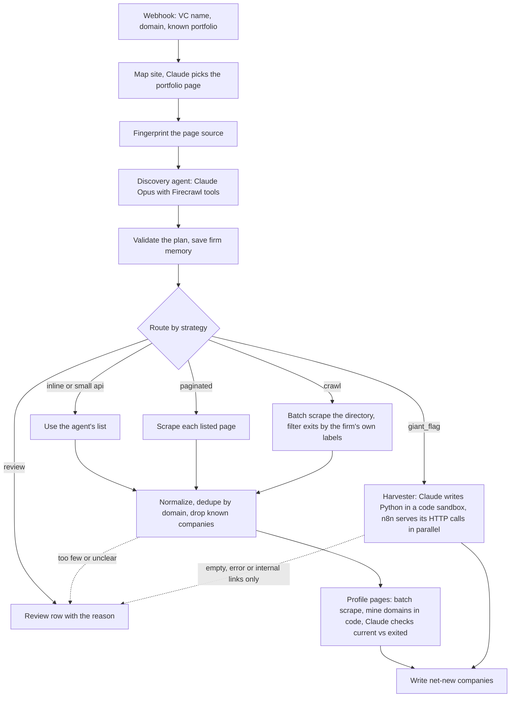

# VC Portfolio Scraper

An n8n workflow that takes a venture firm's name and domain and returns every **current** portfolio company with its real website, deduped against the companies you already have.

Built with n8n, Claude (Anthropic API: tool use, programmatic tool calling, code execution) and Firecrawl v2 (map, scrape, batch scrape, search).

## Why this is hard

No two VC websites store their portfolio the same way. Across the firms this ran on, the list lived in:

- plain links on one page
- a JavaScript grid fed by a WordPress or Algolia API, sometimes with the website and status only on a per-company endpoint three calls deep
- a headless CMS such as Sanity
- a 930 KB JSON array embedded in the page
- a paginated directory, or one profile page per company
- behind a bot wall

Most firms also mix current companies with exits, mergers and IPOs, each labeled in the firm's own words. A fixed scraper breaks on most of them, and writing one scraper per firm does not scale.

## The approach: look first, then pick the cheapest complete method

1. **Find the portfolio page.** Firecrawl maps the site and Claude picks the portfolio page. The pick must be one of the URLs actually found, so it cannot invent one.
2. **Fingerprint the page source** with plain code: Algolia, Typesense, GraphQL, WordPress REST namespaces, Next.js and Nuxt data, Sanity, Contentful, Webflow, embedded JSON blobs and their size, and API calls found in the site's JavaScript bundles.
3. **A discovery agent decides.** Claude Opus with Firecrawl tools reads the page and the fingerprint, then returns a strategy plus notes for the next stage. It never carries a large list itself.
4. **Code validates the plan** before anything runs. Unknown strategies, missing URLs, runaway lists and samples passed off as complete all go to review. The plan is saved as memory for that firm, so the next run starts with one quick check instead of a fresh investigation.
5. **The right executor does the work**, and every run ends with either company rows or a review row that says why.



| Where the portfolio lives | Strategy | Executor |
|---|---|---|
| Links on the page, up to about 150 | `inline` | the agent returns them |
| Small API (total under about 150, at most 3 calls) | `api` | the agent pulls it |
| URL-addressable pages (`?page=2`, A to Z) | `paginated` | a Firecrawl scrape per page |
| A directory with one profile page per company | `crawl` | Firecrawl batch scrape of the directory, then of the profile pages, then a Claude check on current vs exited |
| A large API, a big static list, or an embedded JSON blob | `giant_flag` | the harvester |
| Bot wall, login, or not determinable | `review` | a review row with the reason |

### The harvester

For big jobs, Claude writes Python inside Anthropic's code execution sandbox using programmatic tool calling. The sandbox has no internet. Its code calls an `http_request` tool that n8n services in parallel (8 at a time, up to about 75 calls per round), and the code resumes where it paused. Tool results land in the sandbox, not in the model's context, so token cost scales with rounds, not records. Rate limits and overloads retry with backoff, and a late API failure salvages the work already done.

### Rules that came out of live runs

- Expensive, smart components only make decisions. Cheap, deterministic components move the data.
- The model proposes, code disposes. Every model answer is validated before it is trusted.
- When the firm prints status labels, filter in code, not in prompts.
- Websites are identities, names are not. Dedupe is by registrable domain, and hostnames are compared by equality or dot suffix, never substring (`x.com` is not inside `idrx.com`).
- Every run reports its own accounting (pages, rows, unique, kept, dropped by status), so a bad run can be diagnosed at a glance.
- Nothing fails silently. Every dead end writes a verdict row.

## Results from live runs

| Firm | Where the data lived | Result |
|---|---|---|
| Y Combinator | API | 4,065 companies written in 56 harvester rounds |
| Insight Partners | WordPress API, with website and status only on a per-company endpoint | 515 current companies written, 290 prior investments excluded, about 850 detail calls batched in the sandbox |
| a16z | 930 KB JSON array embedded in the page (the WordPress API was blocked for non-browser clients) | 656 written: 841 entries minus 175 exits, 1 duplicate and 9 already known, reconciled exactly |
| Summit Partners | Paginated directory with status labels | 107 current companies, 107 of 107 domains resolved, using 10 scrape credits instead of about 1,490 for crawling the profile archive |
| Dawn Capital | Sanity CMS behind the site | 40 current companies from the firm's own data. The CMS held 68 records while the page showed about 49, and it carried native exited flags |

## Lessons from debugging

- **One symptom, four causes.** In one day, a crawl returning zero pages had four different causes: a crawl scope default, a stale saved workflow, a cached page hiding a failed render, and a render timeout. What worked was asking for the one artifact that tells the causes apart before patching.
- **A cache hit can hide a failure.** Nothing counts as validated until it has run fresh (`maxAge: 0`).
- **Make a fix's failure look different from the bug it fixes.** If a fix can silently fail, its output should prove whether it ran.
- **Put emit-time rules in the output contract.** The agent ignored a pagination rule written mid-prompt and followed it once the rule moved into the output format block.
- **Repair models can invent data.** A parse failure once sent a correct 200-company answer to a small repair model, which returned a made-up 5-company list. Now a format rule prevents it, a ratio guard catches it, and the repair model is Opus with a 16K token budget.
- **Dense pages truncate LLM extraction.** A single-page directory of about 375 companies stopped at 37 rows. Firecrawl's links format never truncates, so domains are now mined from links and profile pages in code.
- **n8n expressions end at the first `}}`.** Request bodies that contain JSON schemas are built in Code nodes.

## Repo layout

```
workflow/vc-portfolio-scraper.n8n.json   importable n8n workflow, 60 nodes
code/                                    the 22 Code nodes as .js files, in pipeline order
prompts/                                 the discovery agent's system prompt and output schema
```

`workflow/` is the source of truth. `code/` and `prompts/` are read-only copies so the logic is readable on GitHub. Good places to start: `code/04-fingerprint-page-source.js`, `code/06-read-plan.js`, `code/12-crawl-to-companies.js` and `code/20-handle-and-service-tools.js`.

## Setup

1. Import `workflow/vc-portfolio-scraper.n8n.json` into n8n. It was built on n8n Cloud 2.21.
2. Create an Anthropic credential and a Firecrawl credential, and select them on the nodes that ask for one.
3. In `Write to Portco Staging`, `Write harvest → Staging` and `Write review → Staging`, replace `YOUR-WEBHOOK-ID` with your own output webhook. It was built to feed a Clay table, but any endpoint that accepts a JSON POST works.
4. In `Portfolio Discovery Agent`, set Max Iterations to 40.
5. Activate the workflow and POST to `/webhook/portco-agent`. Firm memory only persists on production (webhook) runs.

```json
{
  "vc_account_id": "any-id",
  "vc_name": "Abstract Ventures",
  "vc_domain": "abstract.vc",
  "claygent_portcos": [{ "name": "Acme", "url": "https://acme.com" }]
}
```

`claygent_portcos` is the portfolio you already have, used to suppress known companies. It can be an empty list.

Each company row is `{ vc_account_id, vc_name, vc_domain, portco_name, url, domain }`. A run that cannot produce companies writes a row with a `verdict` (`review`, `no_new`, `internal_links_only`, `crawl_failed`, `harvester_error` or `empty_harvest`) and the reason.

Model names, API versions and Firecrawl parameters reflect June 2026.

## History

An earlier design ran bulk extraction on a small Deno server on Railway, because n8n Code nodes time out after 60 seconds and Supabase Edge Functions hit memory and time limits. The current design moved bulk work into Anthropic's code execution sandbox and deterministic Firecrawl batch jobs, with n8n orchestrating everything.

---

Built by Ethan Lin. Credentials, webhook URLs and internal identifiers have been removed from this copy.
